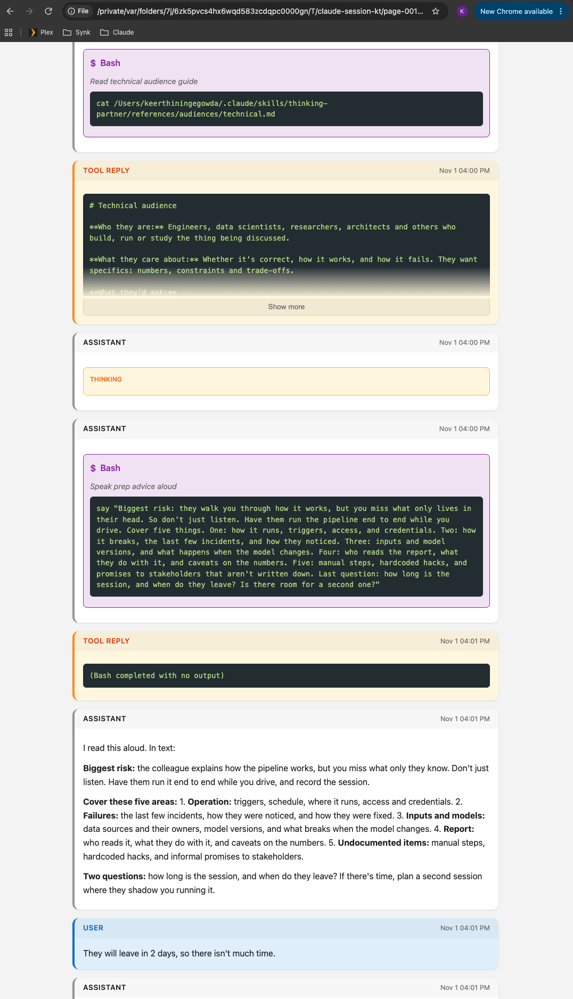

# AI_thinking_partner_skill_and_automated_evals
Building a reusable AI coworker skill and evaling the same - Because how many times have you evaled your crown jewel skills?

## The skill: `thinking-partner`

A Claude skill that acts as a thinking partner for work. It's there for the work, not the person: it doesn't profile you, comment on your mood, or judge how you're performing. You make the decisions; it questions, raises and suggests.


### What it does

- **Thinking it through.** Bounce an idea around, pressure-test a plan, and surface the risks and blind spots you may not see.
- **Preparing for a meeting.** Asks who will be on the other side and what a good outcome looks like (decisions to be made, what you're asking for), then works backward from there.
- **Rehearsing for people.** Plays the audience so you can practice a presentation before the real one.

It looks before it opines, stays inside your problem, and is straight with you. It's deliberately not built for people conversations (1-1s, compensation, performance reviews) or for inferring emotions.

### Modes of communication

1. **Text to text.** You type, it replies in text.
2. **Voice to voice.** You speak using Claude Code's `/voice`, and it speaks its replies back using macOS `say`.

More detail: [behaviour, out-of-scope limits, audiences, repo layout and customizing](docs/thinking-partner.md).

## Eval harness

Run the skill in real Claude Code sessions, read the session traces (JSONL), and score each one against an eval matrix. Every check maps to the part of the skill to change if it fails.

- Three use cases: brainstorming, meeting prep, presentation prep, plus guardrail, triggering and voice checks.
- Full matrix, observed-not-scored items, parked items and pending changes: [evals/eval-plan.md](evals/eval-plan.md).
- Voice: input via `/voice`, spoken output via macOS `say`. Transcription accuracy is observed, not scored.

### Reading your local trace files a.k.a jsonl files

📝 <b>Note:-</b> It is recommended to copy your local session files to somewhere outside of ~/.claude space as they will be automatically deleted after ~30 days - I think

The goal here is to setup a tracing infrastructure given that I dont have access to observability tools like Arize AI or even have a programmatic way of accessing traces using langgraph, langchain or even DSPy.

A jsonl file is too nested to manually go throygh every single line

2 options

<b>1) A quick exploration method using ```claude-code-transcripts ``` - Checkout https://simonwillison.net/2025/Dec/25/claude-code-transcripts/ </b>

I prefer installing the package as opposed to using uvx - Its a personal preference thing if you want to use this package like a standalone tool.
```
uv install code-code-transcripts
```
By default ```uv tool run claude-code-transcripts``` will open an interactive CLI that will let you choose the sessions from ~/.claude/projects. Given that we need to access a specific file path use the following
```
uv tool run claude-code-transcripts json <path to jsonl file>
##You can learn more about this option using
uv tool run claude-code-transcripts json --help
```
<pre>
This will open the transcript in your browser
</pre>




🚨 If you use --gist option, the option will upload the transcripts to github. Not a good idea unless you have scrubbed the transcripts of PII 🚨

As you can see the above method does not scale. A good view for SMEs though

<b>2)Duckdb:- </b> Database for in-process analytics - You can "query" tha trace like a database 

Install using ``` brew install duckdb``` and explore using explore_duck_db.py 

## Scurbbing PII in your traces 

## Parser to do evals against

## Map against the eval table - Scenario X Eval table

## Updates to skill - pending results

## An ode to boundaries and guardrails 