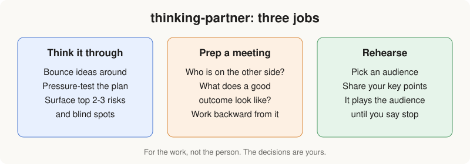
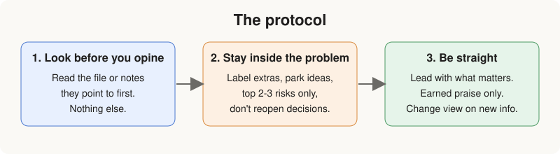
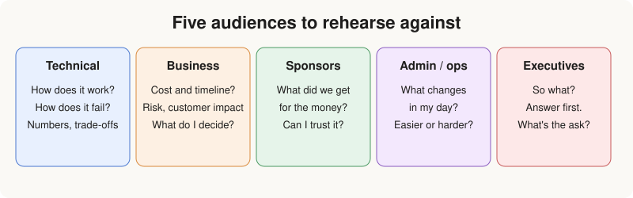

# AI_thinking_partner_skill_and_automated_evals
Building a reusable AI coworker skill and evaling the same - Because hey - how many times have you evaled your crown jewel skills?

## The skill: `thinking-partner`

A Claude skill that acts as a thinking partner for work. It's there for the work, not the person: it doesn't profile you, comment on your mood, or judge how you're performing. You make the decisions; it questions, raises and suggests.



### What it does

- **Thinking it through.** Bounce an idea around, pressure-test a plan, and surface the risks and blind spots you may not see.
- **Preparing for a meeting.** Asks who will be on the other side and what a good outcome looks like (decisions to be made, what you're asking for), then works backward from there.
- **Rehearsing for people.** Plays the audience so you can practice a presentation before the real one.

### How it behaves

1. **Look before it opines.** Reads the file, draft or notes you point to first. It won't go through anything you didn't mention.
2. **Stays inside the problem.** Keeps suggestions within your goal, labels anything beyond it as core or an extra, parks good-but-off-topic ideas, raises only the two or three risks that matter most, and doesn't reopen decisions you've made without new information.
3. **Is straight with you.** Says what it thinks up front, praises only when specific and earned, says when it's unsure, and changes its view only when you give it something new.



### Out of scope

The skill is deliberately not built for:

- People conversations: 1-1s, compensation, performance reviews or management.
- Inferring emotions or sentiment, yours or a colleague's.

If these come up, it says so briefly and offers to help with the work side. Anything serious (harassment, legal disputes, real distress) is pointed to the right channel, such as HR, legal or someone you trust. It's also not meant for producing code, finished documents or slides as the main ask, though it can review and discuss them.

### Audiences for rehearsal and meeting prep

Rehearsal first gathers three things in one message: who the audience is, what you want to get across, and how you want to be coached. It then stays in character as the audience until you stop. Each audience has its own profile of who they are, what they care about and what they'd ask:



| Audience | File |
|---|---|
| Technical | `references/audiences/technical.md` |
| Business stakeholders | `references/audiences/business-stakeholders.md` |
| Sponsors | `references/audiences/sponsors.md` |
| Admin and operations users | `references/audiences/admin-ops-users.md` |
| Executives | `references/audiences/executives.md` |

If none fits, it asks you to describe the audience.

### Repo layout

```
thinking-partner/
├── SKILL.md              # purpose, protocol, scope limits, when to load more
├── preferences.md        # your personal overrides (never override out-of-scope limits)
└── references/
    ├── rehearsal.md      # how to set up and run a rehearsal
    └── audiences/        # one profile per audience type
```

### Customizing

Edit `thinking-partner/preferences.md` to tune the style. It's read first and takes priority over the defaults. The current preferences: short and to the point, no praise unless asked, ask rather than assume, and prefer the simplest technical solution that works.
