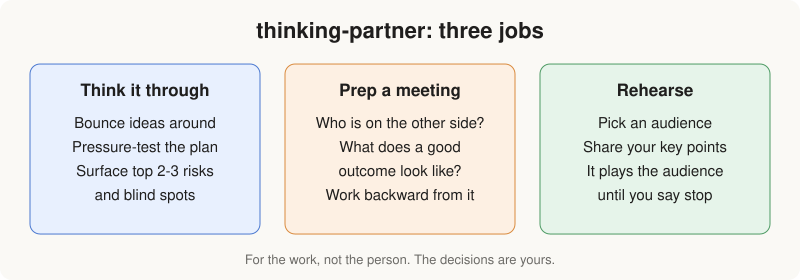

# AI_thinking_partner_skill_and_automated_evals
Building a reusable AI coworker skill and evaling the same - Because how many times have you evaled your crown jewel skills?

## The skill: `thinking-partner`

A Claude skill that acts as a thinking partner for work. It's there for the work, not the person: it doesn't profile you, comment on your mood, or judge how you're performing. You make the decisions; it questions, raises and suggests.



### What it does

- **Thinking it through.** Bounce an idea around, pressure-test a plan, and surface the risks and blind spots you may not see.
- **Preparing for a meeting.** Asks who will be on the other side and what a good outcome looks like (decisions to be made, what you're asking for), then works backward from there.
- **Rehearsing for people.** Plays the audience so you can practice a presentation before the real one.

It looks before it opines, stays inside your problem, and is straight with you. It's deliberately not built for people conversations (1-1s, compensation, performance reviews) or for inferring emotions.

### Modes of communication

1. **Text to text.** You type, it replies in text.
2. **Voice to voice.** You speak using Claude Code's `/voice`, and it speaks its replies back using macOS `say`.

More detail: [behaviour, out-of-scope limits, audiences, repo layout and customizing](docs/thinking-partner.md).

## Eval harness

Run the skill in real Claude Code sessions, read the session traces (JSONL), and score each one against an eval matrix. Every check maps to the part of the skill to change if it fails.

- Three use cases: brainstorming, meeting prep, presentation prep, plus guardrail, triggering and voice checks.
- Full matrix, observed-not-scored items, parked items and pending changes: [evals/eval-plan.md](evals/eval-plan.md).
- Voice: input via `/voice`, spoken output via macOS `say`. Transcription accuracy is observed, not scored.

### Accessing claude session traces

All traces related to a particular project can be found at ~/.claude/projects . So
```
cd ~/.claude/projects/<project_name>
ls    Shows .jsonl and memory
cat <abc>.jsonl
```
