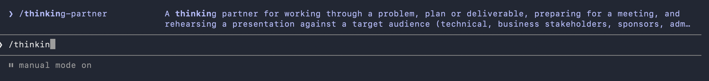

# Setup thinking_partner skill assets into your working session

## Download the skill folder

You will need the <u>unzipped</u> version of thinking-partner/ folder 

## Start a claude code session

Open your terminal and ``` claude ```

And pretty much copy/download the skill folder and ask to add it to its skill repository

<b>**Note:-**</b> You dont need to restart your session once again to check if the skill is available or not

To check if the changes went through type
```
/thinking-partner 
```
It should render the description of the skill itself like the image below

 